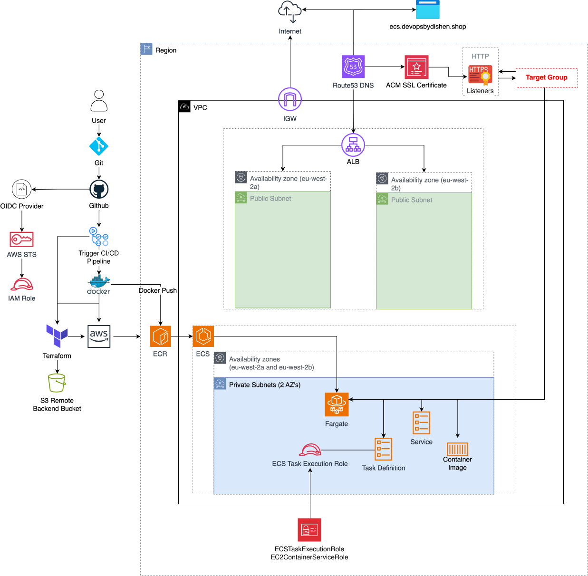

# Production-style AWS ECS deployment of Threat Composer

A containerised deployment of the Threat Composer application on AWS ECS Fargate using Terraform for infrastructure, GitHub Actions for CI/CD, OIDC for secure AWS authentication, and CloudWatch for application logging.

The application runs in private subnets behind an Application Load Balancer with HTTPS provided through ACM and Route 53.

> **Live environment:** Infrastructure was destroyed after validation to avoid unnecessary AWS costs.

## Tech Stack

- **Infrastructure:** AWS, Terraform, S3 remote backend
- **Compute:** ECS Fargate
- **Container Registry:** Amazon ECR
- **Networking:** VPC, ALB, public/private subnets, NAT Gateway, security groups
- **DNS / TLS:** Route 53, ACM
- **CI/CD:** GitHub Actions
- **Authentication:** GitHub OIDC → AWS IAM
- **Observability:** CloudWatch Logs
- **Containerisation:** Docker
- **Security:** Trivy vulnerability gating, non-root runtime


## Live Application


## Architecture




## CI/CD

Four GitHub Actions workflows are used:

## Project Structure

```text
.
├── .github/
│   └── workflows/
│       ├── apply.yaml
│       ├── destroy.yaml
│       ├── docker.yaml
│       └── plan.yaml
│
├── app/
│
├── terraform/
│
├── .gitignore
└── README.md

```

### Infrastructure

Terraform changes are validated through the plan workflow.

Infrastructure deployment is performed manually through the apply workflow:

```text
GitHub Actions
      |
      v
GitHub OIDC Token
      |
      v
AWS IAM Role
      |
      v
Terraform Init / Plan / Apply
      |
      v
AWS Infrastructure
```

No long-lived AWS access keys are stored in GitHub.

### Application Deployment

Application changes trigger the Docker workflow:

```text
Application Change
      |
      v
GitHub Actions
      |
      v
Tests + Production Build + Container Smoke Test
      |
      v
Trivy HIGH/CRITICAL Gate
      |
      v
Push Commit-SHA Image to ECR
      |
      v
Register New Task Definition Revision
      |
      v
Wait for ECS Service Stability and Healthy ALB Targets
```

Pull requests and pushes to `main` run tests, compile the application, build the container, scan it, and exercise `/healthz`, the homepage, and a client-side route without AWS access. Deployment is deliberately manual: running the workflow against `main` with no image tag builds and publishes the current commit SHA, then deploys it through a new ECS task-definition revision.

If the service does not stabilise, the workflow restores the previous task definition and fails. Supplying an existing ECR SHA tag during the manual run provides an explicit redeployment or rollback path without rebuilding the image.

### Container Image

The Docker build compiles Threat Composer and copies only the static output into an unprivileged NGINX runtime. It no longer ships the source tree, development dependencies, or React development server.

Local `linux/amd64` builds on 3 November 2026 measured:

| Image | Size |
|---|---:|
| Previous Node development-server runtime | 224,558,701 bytes (214.16 MiB) |
| Patched NGINX static runtime | 30,840,964 bytes (29.41 MiB) |
| Reduction | 86.3% |

The optimized image returned `200` from `/healthz`, served the homepage and a client-side route, and ran as non-root user `101`. A local Trivy 0.70.0 scan found zero fixable `HIGH` or `CRITICAL` OS/library vulnerabilities at scan time. These are local Docker measurements, not ECR transfer size or live ECS performance results.

The ECS task definition runs:

```text
CPU:              1024
Memory:           4096 MB
OS:               Linux
Architecture:     X86_64
Container Port:   3000
Launch Type:      Fargate
```

## HTTPS and Load Balancing

Public traffic follows this path:

```text
Client
  |
  v
Route 53
  |
  v
ALB :443
  |
  v
Target Group
  |
  v
ECS Task :3000
```

HTTP traffic on port `80` is redirected to HTTPS on port `443`.

TLS is provided by AWS Certificate Manager.

The target group performs HTTP health checks against:

```text
/
```

A healthy deployment was validated with:

```text
Target Health: healthy
HTTP Status:   200
Response Time: ~0.14s
```

## Observability

Application logs are sent from ECS to CloudWatch using the `awslogs` log driver.

```text
/ecs/ecs-threat-composer
```

CloudWatch was used to inspect:

- container startup
- React compilation
- runtime warnings
- ECS deployment behaviour
- ALB health-check timing

## How to Reproduce

### 1. Clone the repository

```bash
git clone <repository-url>
cd ecs-threat-composer-app
```

### 2. Configure AWS authentication

Configure AWS credentials locally for the initial Terraform bootstrap.

GitHub Actions deployments use OIDC rather than stored AWS access keys.

### 3. Initialise Terraform

```bash
terraform -chdir=terraform init
```

### 4. Review the infrastructure plan

```bash
terraform -chdir=terraform plan
```

### 5. Deploy the infrastructure

```bash
terraform -chdir=terraform apply
```

### 6. Build and push the application image

The GitHub Actions Docker workflow builds the application for:

```text
linux/amd64
```

and, only during a manually approved deployment with no existing tag supplied, pushes the SHA-tagged image to Amazon ECR.

### 7. Deploy to ECS

The pipeline registers a task-definition revision that references the immutable SHA-tagged image, updates the service, waits for ECS stability, checks the deployed image, and confirms that the ALB targets are healthy.

To release the current commit, manually run the workflow against `main` and leave the image-tag input blank. To roll back, supply a previously published ECR SHA tag instead. The workflow verifies that an explicitly supplied tag exists before registering and deploying the rollback revision.

## Decisions and Trade-offs

### ECS Fargate over EC2-backed ECS

Fargate was used to avoid managing EC2 worker instances.

This keeps the project focused on container deployment, networking, IAM, and infrastructure automation rather than instance lifecycle management.

### Private ECS Tasks

The ECS tasks run without public IP addresses.

Only the Application Load Balancer can reach the application port through security-group referencing.

This reduces the public attack surface.

### GitHub OIDC over Static AWS Credentials

GitHub Actions authenticates to AWS through OpenID Connect.

This avoids storing long-lived AWS access keys as GitHub secrets and allows the workflows to receive temporary AWS credentials.

### Manual Terraform Apply

Terraform planning is automated while infrastructure application is manually triggered.

This separates infrastructure review from infrastructure modification and avoids automatically applying every Terraform change.

### Immutable SHA Image Tags

Each application image is tagged with the source commit SHA. The workflow records that exact image in a new task-definition revision, verifies it after the service stabilises, and can redeploy an older SHA tag for rollback.

Terraform still defines the baseline task definition used when infrastructure is first created. Application releases create later revisions through CI so normal code delivery does not reapply the full infrastructure stack.

### Single NAT Gateway

A single NAT Gateway was used for outbound connectivity from the private subnets.

This reduces project cost and complexity but introduces a single-AZ dependency for outbound traffic.

A production architecture requiring higher availability could deploy one NAT Gateway per Availability Zone.

## Troubleshooting

### GitHub OIDC Trust Failure

The GitHub Actions workflow initially failed to assume the AWS deployment role.

The IAM trust policy did not match the actual OIDC subject sent by GitHub.

The authentication event was inspected to identify the exact subject value, after which the trust relationship was corrected.

### IAM Inline Policy Size Limit

The GitHub Actions role originally exceeded the AWS inline policy size limit.

The permissions were split into:

```text
ecs-threat-composer-deploy
ecs-threat-composer-iam
```

This retained the required permissions while staying within the IAM policy size limit.

### ECS Task Definition Permissions

Terraform successfully registered an ECS task definition but failed when attempting to read it afterwards.

The issue was IAM resource scoping.

The following actions required wildcard resource scope:

```text
ecs:DescribeTaskDefinition
ecs:DeregisterTaskDefinition
```

Moving them to the wildcard-scoped discovery statement resolved the problem.

### Missing ECR Image

During the original deployment, ECS attempted to start the baseline task definition before an image tagged `latest` existed in ECR.

The task failed with:

```text
CannotPullContainerError
```

The original Docker workflow then:

```text
Built Image
    |
    v
Pushed :latest to ECR
    |
    v
Forced ECS Deployment
    |
    v
Task Started Successfully
```

The current delivery workflow avoids relying on a mutable tag for releases: it verifies or publishes a commit-SHA tag and registers that exact image in a new task-definition revision.

### ALB Health Check Timing

The target initially reported:

```text
Target.Timeout
```

CloudWatch showed that the original React development server was still compiling.

Once compilation completed, the application responded successfully and the target transitioned to:

```text
healthy
```

No infrastructure change was required.

The current image compiles the application during the build and serves static files through NGINX, so that development-server startup delay is no longer part of the runtime design. This has been verified locally but not yet retested in a live ECS service.

## Validation

The original live deployment was validated through:

- successful Terraform GitHub Actions workflow
- successful Docker deployment workflow
- running ECS Fargate task
- healthy ALB target
- ECR image deployment
- CloudWatch application logs
- Route 53 DNS resolution
- ACM HTTPS certificate
- successful HTTPS response

```text
HTTP 200 | total ~0.14s
```

For the current revision, local verification confirms:

- 13 application test suites (25 tests), including the new Save-button behavior checks, pass
- the optimized `linux/amd64` image builds successfully
- `/healthz`, `/`, and a client-side route return successfully
- the container health check reports `healthy`
- the runtime uses non-root user `101`

The infrastructure remains destroyed to avoid AWS charges. The new SHA-tag deployment, automatic failed-deployment restoration, ECS stability wait and ALB target-health check are configured in CI but have not yet been executed against a live service.

## Evidence

### Terraform Deployment


### Application Deployment


### ECS Service


### Healthy Target


### ECR Image


### CloudWatch Logs


## Project Structure

```text
.
├── .github/
│   └── workflows/
│       ├── apply.yaml
│       ├── destroy.yaml
│       ├── docker.yaml
│       └── plan.yaml
│
├── app/
│
├── terraform/
│   ├── modules/
│   │   ├── alb/
│   │   ├── ecs/
│   │   ├── route53/
│   │   └── vpc/
│   │
│   ├── ecr.tf
│   ├── iam.tf
│   ├── main.tf
│   ├── outputs.tf
│   └── providers.tf
│
├── docs/
│   ├── architecture.png
│   └── screenshots/
│
└── README.md
```

## Cleanup

The AWS infrastructure was destroyed after validation to prevent unnecessary cloud costs.

The account was checked for remaining project resources including:

- ECS and EKS clusters
- EC2 instances
- NAT Gateways
- Application Load Balancers
- Elastic IP addresses
- EBS volumes
- ECR repositories
- RDS instances
- ElastiCache clusters
- ACM certificates

No active compute, networking, database, or load-balancing resources remained after cleanup.
